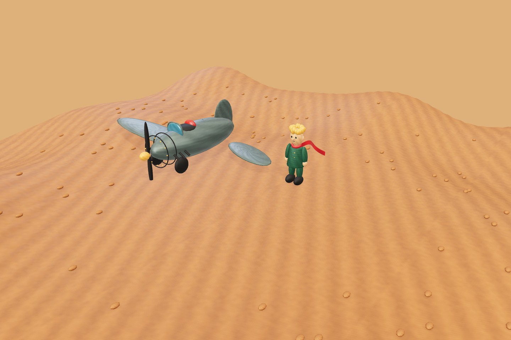
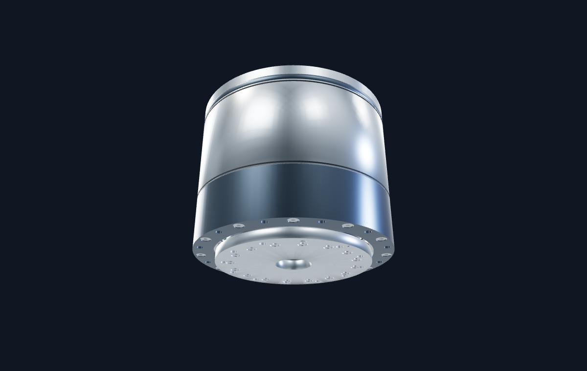

# virtualworldAI

**把想象变成可以进入、探索和继续创作的 3D 世界。**

virtualworldAI 是一个基于浏览器的三维世界创作与交付项目。你可以用文字描述世界、在配置视觉模型后使用参考图，也可以直接打开内置场景；通过共享的 SceneSpec 场景协议，在沉浸式体验、高级编辑和独立导出之间衔接。项目默认在本地运行。

[快速开始](#快速开始) · [场景预览](#场景预览) · [Unreal 本机验收](docs/unreal-local-acceptance.md) · [工程导出](#导出与引擎互操作) · [技术架构](#技术架构)

## 场景预览

|                                小王子 · 沙漠相遇                                |                                      H-100 · 谐波关节                                       |
| :-----------------------------------------------------------------------------: | :-----------------------------------------------------------------------------------------: |
|  |  |
|                   可行走的叙事场景，包含角色、互动与章节进度                    |                       可旋转观察的机构演示，支持剖视、爆炸和传动控制                        |

> 以上为仓库中**真实内置场景的预览图**，并非整个网页界面的截图。实际运行时可以改变镜头、进入场景并操作；画面取决于视角、浏览器和显卡。更多场景细节见[小王子与机构案例](docs/blender-showcases.md)。

## 当前能力

- **描述 → 生成 → 探索 → 再编辑**：从首页输入文字创建世界，查看生成任务状态；可选择显式的本地程序化规划，或配置 LLM 进行 AI 规划与局部编辑提案。
- **沉浸式 3D 体验**：第三人称移动、场景热点与剧情任务、章节进度、画质切换、暂停和触屏控制；小王子 B-612 章节含球面行走与径向重力。
- **高级场景编辑**：场景树、属性调整、节点增删、撤销/重做、资产导入、保存与导出。SceneSpec 是持久化的统一场景数据；交互进度与机构播放状态独立保存。
- **多类型资产**：自包含 GLB、STEP/STP、SPZ、Gaussian PLY；STEP 经浏览器端 OCCT 转换，点云由 Spark 按需加载。导入兼容性和工程准确性仍需校验。
- **WebGL 2 渲染恢复**：图形初始化失败或上下文丢失时提供持续可见的错误说明、暂停和重试；无法代替浏览器或驱动恢复。
- **Unity / Unreal 原生运行源码**：为小王子章节、角色移动与剧情，以及 H-100 机构提供 C# / C++ 运行代码和本地工程生成命令。网页可连接已部署的 Unity Web 或 Unreal Pixel Streaming；原生编译与实机验收状态见[验收记录](docs/validation-native-engines.md)。

### 内置体验

| 体验                  | 内容                                                                  | 入口                                               |
| --------------------- | --------------------------------------------------------------------- | -------------------------------------------------- |
| **小王子 · 三章旅程** | 沙漠相遇 → B-612 星球 → 地球玫瑰园与狐狸；互动解锁、继续与重置        | 首页「探索世界」或 `?project=little-prince-desert` |
| **H-100 谐波关节**    | 自绘紧凑关节、200/202 齿传动示意、旋转观察、部件聚焦/隔离、剖视和爆炸 | 首页「探索世界」或 `?project=demo-harmonic-joint`  |

H-100 的主体名义外形约为 **Ø100 × 84.3 mm**，通孔 Ø18 mm，属于参照公开资料的原创教学模型，**不是可直接制造的厂商 CAD**；其内部结构、齿廓与受力均有演示简化。参见 [H-100 结构与验证](docs/h100-joint-module.md)。

## 快速开始

要求 **Node.js 24**、npm，以及支持 **WebGL 2** 的浏览器（建议启用 GPU 加速）。

```bash
npm ci
npm run dev
```

打开 **http://127.0.0.1:5173/**，即可访问首页并进入两个内置体验；无需模型密钥。首页优先展示场景封面，实时预览在画面可见且浏览器空闲后加载。

从首页底部进入 **高级编辑**，或使用 `?edit=1&project=demo-harmonic-joint`。按需运行生产构建：

```bash
npm run build
npm start
```

构建后的服务默认地址为 **http://127.0.0.1:3001/**。Blender **不是**启动或体验内置场景的必需依赖，仅在重建固定模型配方时使用。

## 创建自己的世界

**无需密钥**：首页可使用明确标注的「程序化」模式，也可从 CLI 构建一个场景：

```bash
npm run world:generate -- --id my-first-world --description "一座被云海环绕的漂浮花园" --planner builtin
npm run world:validate -- --world worlds/my-first-world
```

`builtin` 模式不会调用大模型，也不理解参考图片；生成世界可在本地项目目录中打开和继续编辑。

**使用 AI**：将 `.env.example` 复制为 `.env`，配置服务端的 `LLM_BASE_URL`、`LLM_MODEL`、`LLM_API_KEY`。可用的视觉模型支持 PNG/JPEG 参考图；选择 Tripo 资产生成时另外配置 `TRIPO_API_KEY` 等参数，并在界面明确确认可能产生的费用。生成任务保留状态与恢复信息，**付费任务创建不会自动重试**。密钥仅供服务端/CLI 读取。

具体的任务恢复与资产记录参见 [生成与资产说明](assets/manifests/README.md) 和 [架构说明](docs/architecture.md)。

## 导出与引擎互操作

高级编辑中的「导出目标」提供四个交付选项：

| 目标                  | 当前交付内容                                                        | 使用方式                                                                                       |
| --------------------- | ------------------------------------------------------------------- | ---------------------------------------------------------------------------------------------- |
| **网页（默认）**      | 自包含资源、场景数据与独立 Web 播放器 ZIP                           | 解压后通过 HTTP 服务打开 `index.html`；不依赖创作后端或模型 API，不能直接使用 `file://`        |
| **Godot 4**           | `project.godot`、`main.tscn`、原生导入脚本、规范化 GLB 和兼容性报告 | 解压并使用 Godot 打开工程，检查导入后场景                                                      |
| **Unity 6**           | GLB、C# 原生运行时、场景/预制体导入工具与兼容性报告                 | 在现有 Unity 工程安装 glTFast **6.14.1** 后按 `README-Unity.md` 导入；CLI 可准备完整新工程目录 |
| **Unreal Engine 5.x** | `.uproject`、C++ 原生运行时、固定版本插件/字体、环境诊断与验收脚本  | 自动查找本机 UE；源码基线 5.4+，实际小版本兼容性以本机编译为准                                 |

为内置场景生成原生源工程：

```bash
npm run native:export -- --target unity --scene little-prince-desert --out output/native/prince-unity
npm run native:export -- --target unreal --scene demo-harmonic-joint --out output/native/joint-unreal
```

两种引擎都可选择小王子或 H-100；小王子工程包含三章及完整角色资源。目标目录必须不存在。**原生运行源码已接入导出流程，但本次环境没有 Unity / Unreal Editor，尚未完成真实原生编译、画面和操控验收。** Godot 保留现有场景互操作范围与历史验证记录。通用关节、点云、动态形变碰撞和材质逐像素一致性仍有边界。

### 已安装 Unreal 5：生成本机验收目录

```powershell
npm run unreal:prepare -- --out output/unreal-review
```

双击生成目录中的 **Review.cmd**：先检查环境，再选择小王子沙漠/B612/地球或关节模组。
启动项会准备固定插件与中文字体、编译并运行实际 Unreal；可单独打开 Editor、运行原生 smoke，
并收集日志和人工验收表。首次需下载依赖，C++ 工具链仍须本机安装。
引擎路径可通过 `node review.mjs menu --engine "D:/Epic Games/UE_5.7"` 指定，请改成真实路径。
完整操作、真实验收项目与故障处理见 **[Unreal 本地验收指南](docs/unreal-local-acceptance.md)**。

要让当前体验由游戏引擎渲染，先构建并部署 Unity Web 或 Unreal Pixel Streaming，再按场景及修订号配置 `VW_ENGINE_RUNTIMES`。选择原生引擎时会卸载 Three.js 体验；未配置或版本过期时显示说明。新代码不会自动启动本地引擎或创建云 GPU 服务。完整步骤见 [Unity / Unreal 运行指南](docs/native-engine-runtimes.md)，数据协议见 [引擎互操作说明](docs/engine-interoperability.md)。

## 技术架构

| 层次       | 主要技术 / 职责                                                                        |
| ---------- | -------------------------------------------------------------------------------------- |
| Web 应用   | React 19、TypeScript、Vite、Fastify                                                    |
| 3D 运行时  | 网页 Three.js / Rapier / Spark；Unity C# 与 Unreal C++ 原生适配源码                    |
| 场景协议   | SceneSpec、Zod 校验、原子 SceneCommands、撤销与版本控制                                |
| 生成与资产 | LLM 规划、可选 Tripo、Blender 固定批处理、glTF Transform、Khronos Validator、OCCT WASM |
| 交付       | 独立网页播放器、Unity 6 / Unreal 5.x 原生源工程与本机验收目录、Godot 4 场景导出        |

```text
apps/web/                   首页、体验、高级编辑、Fastify 服务与播放器
packages/engine/            Three.js 场景、渲染与图形恢复
packages/scene-schema/      SceneSpec 与 SceneCommands
packages/interaction/       行走、机构状态、故事任务与存档
packages/asset-runtime/     GLB、CAD、点云资源加载与释放
generators/                 AI 规划、Tripo、Blender、世界构建 CLI
worlds/                     内置 H-100 与小王子三章
assets/                     原始资产、优化资源与校验清单
tests/                      单元、集成、浏览器与案例检查
docs/                       设计、部署、验证与互操作文档
```

开发细节见 [架构文档](docs/architecture.md)。本地项目与新生成资产通常保存于非版本控制的数据目录；升级或迁移前请备份对应的项目、资产及场景文件。

## 验证

```bash
npm test
npm run check
npm run build
npm run demos:validate
npm run test:browser
npm run test:showcases
npm run test:webgl
npm run format:check
```

浏览器测试需要可用的 Edge/Chrome 或 Playwright Chromium；必要时设置 `PLAYWRIGHT_EXECUTABLE_PATH`。截图和回归报告默认位于未纳入版本控制的 `output/playwright/`。这些命令是**可执行的检查入口**，不代表本次 README 调整已重新执行全部测试。

## 当前边界与文档

目前提供本地创作与**私有单工作区**部署能力，不包含公开多租户服务、实时协同编辑或多人联机。Blender MCP、AI 直接操作外部三维软件、跨引擎双向编辑和存档同步尚未实现。Unity / Unreal 源工程仍需原生实机验收；真实付费模型的输出质量不能由本地测试夹具证明。

- [部署与团队访问](docs/deployment.md)
- [引擎互操作与兼容性](docs/engine-interoperability.md)
- [Unity / Unreal 原生运行与网页接入](docs/native-engine-runtimes.md)
- [Unreal 5 本地验收：小王子与关节模组](docs/unreal-local-acceptance.md)
- [场景案例与模型验证](docs/blender-showcases.md)
- [WebGL 故障恢复](docs/webgl-recovery.md)
- [平台底座与资产校验](docs/platform-foundation-audit.md)
- [第三方声明](THIRD_PARTY_NOTICES.md)
