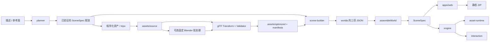

# AI 3D World Generator 架构

本次按用户指定目录及[分享原文](https://chatgpt.com/share/6ad3932f-7324-83ec-901a-2e1392061887)迁移。工作区仍位于 `virtualworld/`，npm 项目名为 `ai-3d-world-generator`，没有再嵌套一份同名工程。历史设计保留在 `docs/superpowers/`；本页描述当前实现。

## 模块与实际调用

```text
apps/web/
  src/                  React 编辑器、视口接入、导入交互
  server/               本地 HTTP、项目保存、资源接收、静态 ZIP
  player/               独立体验入口，复用同一个引擎
packages/
  scene-schema/src/     Zod SceneSpec、原子命令、撤销栈、节点工厂
  engine/src/           Three.js 场景编译、镜头、选择、变换、渲染与诊断
  interaction/src/      剧情状态机、Rapier 角色、原创角色造型、SaveSystem
  asset-runtime/src/    AssetRegistry、GLB 实例与释放、CAD 数据转换
generators/
  planner/src/          HTTP LLM 编辑提案与完整世界规划；显式 builtin 模式
  tripo/src/            Tripo v3 创建、轮询、下载、图片上传、持久任务账本
  blender/             固定 Python 批处理与无 shell 的进程调用
  scene-builder/src/    三文档编译、层级组装、文件 IO、资产优化、生成 CLI
assets/
  source/              原始 CAD、下载模型、图片、程序化源配方
  optimized/           供浏览器直接读取的 GLB / Gaussian PLY / SPZ
  manifests/           输入输出哈希、版本、Provider / 模型 / 任务与校验记录
worlds/demo-island/     scene.json + story.json + assets.json
worlds/demo-industrial/ 同样的文档结构
worlds/demo-harmonic-joint/ 参数化关节三文档
worlds/little-prince/    campaign.json + chapters/* 的三文档
tests/{assets,engine,e2e}/
```

内部模块通过 `@virtualworld/*` 公开入口引用，workspace 声明真实依赖；跨包不深引 `src/`。浏览器运行包不依赖 `apps` 或 `generators`。`scene-builder` 的默认入口仅包含纯文档组装和 Three 对象层级转换；Node IO、优化和 CLI 是独立入口，不会被播放器导入。依赖边界由 `tests/engine/architecture.test.ts` 检查。



## 数据源与编辑事务

`scene.json` 存几何、变换、环境、镜头与出生点；`story.json` 存任务和按稳定节点 ID 索引的交互；`assets.json` 存运行资产。三者都是版本 1，并通过 `worldId` 与场景 ID 对齐。`assembleWorld` 拒绝身份不一致、悬空故事引用及无效 SceneSpec，`splitWorld` 提供可逆拆分。

编译后的 SceneSpec 是编辑器、引擎和导出的统一协议。项目编辑仍保存到 `data/projects/<id>.json`，不会同时改写模板与生成配方；磁盘上的项目编辑优先于同 ID 的世界模板。未编辑的世界由 `worlds/` 读取并列入项目菜单。原有 `demo-world`、`demo-industrial` ID 保持可用。

所有编辑通过 `applyCommands(scene, baseRevision, commands)`，整批克隆、校验并增加修订。场景校验包括 ID、父子环、有限数值、正尺寸、资源类型、关节范围、剧情先决条件可达性。`SceneHistory` 支持 100 次会话撤销。异步导入和模型请求绑定项目 ID 和切换代次，旧结果不能写入新项目。

单位为米、Y-up、弧度。GLB 的 `assetNode` 是最终 GLTFLoader 场景下的子索引路径，CAD 导出后先重载 GLB 再派生路径。AI 推断的关节强制 `confirmed:false`。工业参数和碰撞代理仍需人工核对。

## 生成、缓存与验证

`world:generate` 在本地运行。`--planner llm` 通过配置的 Chat Completions HTTP 服务生成完整、可验证的声明式世界；参考图使用图片消息。无效输出最多修复一次。`--planner builtin` 是明确标注的确定性程序化模式，只接受文字，不伪装为 AI，也不理解图片。

`--assets tripo` 顺序执行最多 8 个资产请求。参考图可为 PNG/JPEG 文件或 HTTP URL；本地图片通过官方 `/v3/files` 上传，首个资产使用 image-to-model，其余使用 text-to-model。默认模型固定为 `v3.1-20260211`，可由环境变量覆盖。实现依据 [Tripo 官方任务流程](https://developers.tripo3d.ai/en/docs/quick-start)、[图片生成接口](https://developers.tripo3d.ai/en/docs/generation-image-to-model/standard)和[文件上传接口](https://developers.tripo3d.ai/en/docs/files)，不表示已连接真实付费服务。

创建付费任务前先持久化 `creating` 状态并持有独占文件锁。创建 POST 从不自动重试；若结果不明，后续调用拒绝重复提交。拿到 task ID 后轮询失败/超时可恢复原任务，查询最多有限重试。默认总超时 300 秒、轮询间隔 2 秒。下载上限 100 MiB，CDN 下载不携带 API Key。请求缓存包括输入、模型、适配器版本、服务地址，不以可轮换的 API Key 作为内容身份。锁文件记录 PID；进程异常退出后应先核对进程和账本再清理残留锁。

已验证的规划先落盘，恢复过程复用同一规划。最终缓存同时检查场景和运行资产：丢失/损坏的 GLB 从保留的原始模型与任务账本重建，不再次创建付费任务。同 ID 已有不同内容会直接拒绝覆盖；使用新 `--id` 生成新版本。未知创建结果可从供应商控制台找回 task ID，再用同一命令追加 `--task-id`；多资产规划还要指定 `--task-node <nodeId>`。

默认优化采用 [glTF Transform](https://gltf-transform.dev/) 的 dedup、weld、prune，保留已支持的材质扩展，不启用需要额外浏览器解码器的压缩。输入输出都运行 [Khronos glTF Validator](https://github.com/KhronosGroup/glTF-Validator)，错误阻止发布，警告完整保留。生成的视觉模型按目标尺寸归一化；CAD 导入路径不会执行此归一化。

`--blender` 调用仓库固定脚本，使用 `execFile`、独立输入输出、超时和检查过的简化比例；不执行 AI 生成的 Python。固定脚本可用于稳定批处理。Blender MCP 属于后续交互探索接入，本项目没有声称已连接 MCP 服务。

## 资产与运行生命周期

`AssetRegistry` 负责每场景 GLB 缓存、节点路径实例化、独立材质/纹理、Skeleton 克隆、Spark 按需初始化及源缓存释放。销毁中的异步初始化不会创建新的 SparkRenderer。引擎负责每个场景实例的 Mesh、阴影、辅助线和角色物理释放。GPU 稳定计数检查与延迟初始化回归不等于长期无泄漏证明。

`SaveSystem` 单独使用浏览器 localStorage，以世界 ID 和剧情指纹隔离进度。加载检查结构与剧情条件，剧情改变时回到初始状态，存储损坏或被禁用时降级为当前会话。退出/重入体验可继续任务，「重置旅程」清除存档。存档不写入 SceneSpec，也不随导出 ZIP 携带。

角色支持平面 WASD，以及由 `navigation:{kind:'sphere',center,radius}` 明确声明的球面切线运动、径向重力与表面法线相机。静态 `mesh` 碰撞从实际加载对象的世界坐标三角形生成；球面可用显式球体与障碍代理。`actor` 声明角色 GLB、高度和 Idle/Walk/Interact 片段；节点 `animation` 声明独立环境动画。实例释放包含骨骼纹理。球面相机适配固定 Three r180 的 OrbitControls 缓存基底，升级 Three 时必须运行完整绕行回归测试。

`campaign.json` 定义有序章节、相对目录和完成依赖，SceneSpec 的可选 `campaign` 对齐合集 ID、章节 ID、序号。`/api/campaigns` 提供章节目录，服务端在读取、保存和导出时校验成员身份。`CampaignProgress` 从经 SaveSystem 验证的章节状态推导解锁；选择和进度均支持存储不可用时的会话回退，场景 JSON 不保存试玩状态。章节采用按需加载资产，未实现多世界预加载或空间传送。

工业场景的可选 `mechanism` 声明谐波运动根节点、固定件、200/202 齿、剖视替代件、尺寸和双波 morph 名称。SceneSpec 拒绝运动根节点嵌套、固定件被运动根节点带动和无效尺寸关系。输入角度与瞬态剖视/展开由同一个运行时驱动，不回写模板。Blender 的固定配方与名义几何检查独立于 Three 渲染。电影镜头编排、NavMesh、骨骼轨道编辑、工程接触/应力求解和复杂剧情动作仍未实现。

## 本地服务与交付

`apps/web/server` 绑定回环，负责 `/api/projects`、`/api/assets`、`/api/agent`、`/api/validate` 和 `/api/export`。`/assets/optimized/*` 提供项目资产；开发时由 Vite 代理。上传原件和运行文件分存 source/optimized，以 manifest 关联；STEP 派生 GLB 记录源 asset ID。旧 `data/assets/` 与 `/fixtures/` 继续可读，无需破坏性迁移。

API 的资源校验检查 SceneSpec 和文件存在性；CLI `world:validate` 另外校验 GLB 内容。两种校验边界不同。导出重写所有资源为相对 URL，包含静态播放器和许可证；无需模型接口、CDN、编辑服务。独立播放器等待加载完成后启动角色，避免资产未就绪时创建物理世界。端口隔离的浏览器测试验证服务关闭后的子目录部署。
