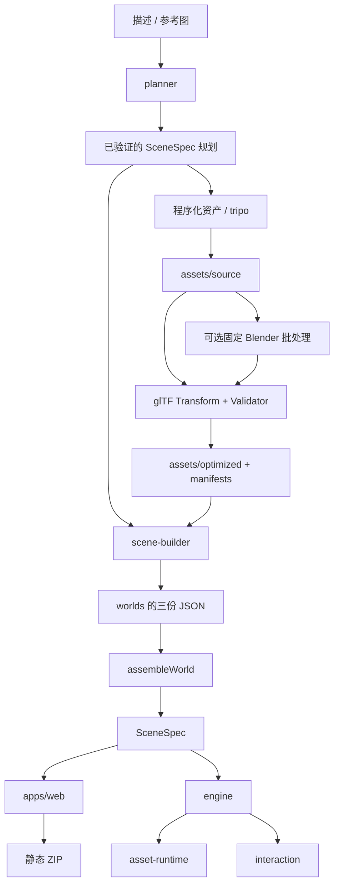

# AI 3D World Generator 架构

本次按用户指定目录及[分享原文](https://chatgpt.com/share/6ad3932f-7324-83ec-901a-2e1392061887)迁移。工作区仍位于 `virtualworld/`，npm 项目名为 `ai-3d-world-generator`，没有再嵌套一份同名工程。历史设计保留在 `docs/superpowers/`；本页描述当前实现。

## 技术路线与阶段边界

当前继续使用锁文件固定的 React 19.2、Three.js 0.180、Rapier 0.19.3、Spark 2.3.1、TypeScript、Vite 与 Fastify，运行环境为 Node.js 24。此前已优化加载、共享交互、资源交付与 WebGL 异常恢复；本次继续补齐导入保真、发布校验、后台容量和私有团队托管。保留 SceneSpec、资产协议和编辑器／播放器共享运行时，不改模型几何、工程尺寸或第三方版本。完整审查见[技术底座审查](platform-foundation-audit.md)。

| 阶段                   | 当前落实                                                                                   | 边界与后续条件                                                                         |
| ---------------------- | ------------------------------------------------------------------------------------------ | -------------------------------------------------------------------------------------- |
| 首页与体验入口         | 首页先呈现现有海报；可见且浏览器空闲后才加载实时预览，进入世界时才加载体验模块             | 这是新增的应用加载边界；Three 运行代码仍需在启动预览／体验时下载和执行                 |
| 物理与点云             | 保留 Rapier 在世界探索时、Spark 在 splat 场景中按需加载的已有路径                          | 本轮没有把既有懒加载列为新增功能，也没有增加新渲染后端                                 |
| 共享展示交互           | 小王子使用同一互动可用性规则、热点与范围检查；H-100 使用同一部件选择、聚焦、隔离和展示控件 | 普通应用、独立播放器与高级编辑中的对应控件复用实现；剧情进度和展示状态不写入 SceneSpec |
| 静态交付与渲染生命周期 | 大文件流式响应、带内容验证器的条件请求；固定名称 GLB 重新验证；截图时即时渲染              | 只有带内容散列的构建脚本／样式使用 immutable；截图不要求每帧保留 drawing buffer        |
| WebGL 异常恢复         | 共享图形状态、持久错误面板与重试；同一 runtime 暂停输入／模拟并重建 GPU 资源               | 用户暂停与可见性挂起独立保留；浏览器持续丢失连接时只能等待恢复，不能由应用强制修复     |
| 模型与后台基础         | 复杂 GLB 保留整棵层级；上传与导出检查兼容性；生成和重操作有容量上限；导出异步压缩          | glTF 结构有效不代表视觉、物理或工程正确；ZIP 仍在内存中组装                            |
| 私有团队托管           | 认证 TLS 网关、单服务占用保护、持久生成目录、修订冲突与安全错误响应                        | 同一个共享工作区；没有用户级 ACL、合并编辑或实时多人游戏                               |
| 下一阶段               | 增量 SceneCommands 内容更新、跨修订缓存与对应取消／资源所有权回归                          | runtime 和 renderer 已保留；目前仍清理并重建场景内容，需先量化编辑和资源开销           |
| 后续扩展               | 大世界流式加载、独立处理 worker、数据库和更先进的 GPU 路径                                 | 按资产规模、任务负载和权限需求演进；本次保留模块化单体                                 |

### 首页初始 JavaScript 体积（PR #5 历史测量）

以下记录来自 PR #5 合并前的生产构建，对基线 `/tmp/virtualworld-baseline-dist/web` 与当时 `dist/web` 的 `index.html` 模块入口进行了本地测量；不代表后续 WebGL 恢复修改后的体积。用 Rollup AST 递归跟随静态 `import`／带源地址的 `export`，排除动态 `import()` 及 Vite 的动态依赖预加载索引。两版入口均无额外静态 JavaScript import，因此入口体积等于初始 JavaScript 静态闭包体积。

| 测量项                      |    基线 | PR #5 构建 |              减少 |
| --------------------------- | ------: | ---------: | ----------------: |
| 模块入口 raw bytes          | 984,629 |    271,283 | 713,346（72.45%） |
| 模块入口 gzip bytes         | 268,214 |     81,821 | 186,393（69.49%） |
| 初始静态 JS 闭包 raw bytes  | 984,629 |    271,283 | 713,346（72.45%） |
| 初始静态 JS 闭包 gzip bytes | 268,214 |     81,821 | 186,393（69.49%） |

对应入口为基线 `assets/index-C3FEiV8w.js`、PR #5 的 `assets/index-BQIJ4Xfu.js`；gzip 使用 Node.js `zlib.gzipSync` 的默认参数逐文件计算后相加。此表只衡量初始 JavaScript，不包含 HTML、CSS、海报、模型或稍后加载的 runtime、LivePreview、WorldExperience、Rapier、Spark chunks。gzip 是同一参数下的压缩体积估计，不代表本地服务已经启用 HTTP gzip，也不等于首屏时间或帧率测量；开始实时预览后仍会加载运行时代码。

## 模块与实际调用

```text
apps/web/
  src/                  React 编辑器、视口接入、导入交互
  server/               本地／私有托管 HTTP、项目与任务、资源校验、异步 ZIP
  player/               独立体验入口，复用同一个引擎
packages/
  scene-schema/src/     Zod SceneSpec、原子命令、撤销栈、节点工厂
  engine/src/           Three.js 场景编译、镜头、选择、变换、渲染与诊断
  interaction/src/      剧情状态机、Rapier 角色、原创角色造型、SaveSystem
  asset-runtime/src/    AssetRegistry、GLB 实例与释放、CAD 数据转换
generators/
  planner/src/          HTTP LLM 编辑提案与完整世界规划；显式 builtin 模式
  tripo/src/            Tripo v3 创建、轮询、下载、图片上传、持久任务账本
  blender/             固定 Python 批处理与无 shell 的进程调用
  scene-builder/src/    三文档编译、层级组装、文件 IO、资产优化、生成 CLI
assets/
  source/              原始 CAD、下载模型、图片、程序化源配方
  optimized/           供浏览器直接读取的 GLB / Gaussian PLY / SPZ
  manifests/           输入输出哈希、版本、Provider / 模型 / 任务与校验记录
worlds/demo-harmonic-joint/ 参数化关节三文档
worlds/little-prince/    campaign.json + chapters/* 的三文档
tests/{assets,engine,e2e}/
```

内部模块通过 `@virtualworld/*` 公开入口引用，workspace 声明真实依赖；跨包不深引 `src/`。浏览器运行包不依赖 `apps` 或 `generators`。`scene-builder` 的默认入口仅包含纯文档组装和 Three 对象层级转换；Node IO、优化和 CLI 是独立入口，不会被播放器导入。依赖边界由 `tests/engine/architecture.test.ts` 检查。



## 数据源与编辑事务

`scene.json` 存几何、变换、环境、镜头与出生点；`story.json` 存任务和按稳定节点 ID 索引的交互；`assets.json` 存运行资产。三者都是版本 1，并通过 `worldId` 与场景 ID 对齐。`assembleWorld` 拒绝身份不一致、悬空故事引用及无效 SceneSpec，`splitWorld` 提供可逆拆分。

编译后的 SceneSpec 是编辑器、引擎和导出的统一协议。项目编辑仍保存到 `data/projects/<id>.json`，不会同时改写模板与生成配方；磁盘上的项目编辑优先于同 ID 的世界模板。未编辑的世界由 `worlds/` 读取并列入项目菜单。内置目录仅包含 H-100 和小王子三章；J-01、星屿来信、沙漠绿洲、宁静森林的四个旧 ID 已退役，旧持久文件不会使它们重现。回归几何仅在 `tests/fixtures` 保留，应用和生成器入口不依赖测试案例。新建项目使用空白 SceneSpec。

所有编辑通过 `applyCommands(scene, baseRevision, commands)`，整批克隆、校验并增加修订。场景校验包括 ID、父子环、有限数值、正尺寸、资源类型、关节范围、剧情先决条件可达性。`SceneHistory` 支持 100 次会话撤销。异步导入和模型请求绑定项目 ID 和切换代次，旧结果不能写入新项目。

单位为米、Y-up、弧度。GLB 的 `assetNode` 是最终 GLTFLoader 场景下的子索引路径，CAD 导出后先重载 GLB 再派生路径。AI 推断的关节强制 `confirmed:false`。工业参数和碰撞代理仍需人工核对。

纯静态、正尺度的普通 Mesh 层级仍可拆为 SceneSpec 部件。含骨骼、动画、负尺度、非 Mesh 对象或不能无损表示的变换时，导入保留 GLB 整个根节点，以单位变换包裹；首个符合现有命名约束的动画片段可循环播放。这样保留原资产语义，代价是复杂模型暂不拆成可逐部件编辑的节点，也没有新增动画轨道或片段选择界面。

## 生成、缓存与验证

`world:generate` 在本地运行。`--planner llm` 通过配置的 Chat Completions HTTP 服务生成完整、可验证的声明式世界；参考图使用图片消息。无效输出最多修复一次。`--planner builtin` 是明确标注的确定性程序化模式，只接受文字，不伪装为 AI，也不理解图片。

`--assets tripo` 顺序执行最多 8 个资产请求。参考图可为 PNG/JPEG 文件或 HTTP URL；本地图片通过官方 `/v3/files` 上传，首个资产使用 image-to-model，其余使用 text-to-model。默认模型固定为 `v3.1-20260211`，可由环境变量覆盖。实现依据 [Tripo 官方任务流程](https://developers.tripo3d.ai/en/docs/quick-start)、[图片生成接口](https://developers.tripo3d.ai/en/docs/generation-image-to-model/standard)和[文件上传接口](https://developers.tripo3d.ai/en/docs/files)，不表示已连接真实付费服务。

创建付费任务前先持久化 `creating` 状态并持有独占文件锁。创建 POST 从不自动重试；若结果不明，后续调用拒绝重复提交。拿到 task ID 后轮询失败/超时可恢复原任务，查询最多有限重试。默认总超时 300 秒、轮询间隔 2 秒。下载上限 100 MiB，CDN 下载不携带 API Key。请求缓存包括输入、模型、适配器版本、服务地址，不以可轮换的 API Key 作为内容身份。锁文件记录 PID；进程异常退出后应先核对进程和账本再清理残留锁。

已验证的规划先落盘，恢复过程复用同一规划。最终缓存同时检查场景和运行资产：丢失/损坏的 GLB 从保留的原始模型与任务账本重建，不再次创建付费任务。同 ID 已有不同内容会直接拒绝覆盖；使用新 `--id` 生成新版本。未知创建结果可从供应商控制台找回 task ID，再用同一命令追加 `--task-id`；多资产规划还要指定 `--task-node <nodeId>`。

默认优化采用 [glTF Transform](https://gltf-transform.dev/) 的 dedup、weld、prune，保留已支持的材质扩展，不启用需要额外浏览器解码器的压缩。输入输出都运行 [Khronos glTF Validator](https://github.com/KhronosGroup/glTF-Validator)，错误阻止发布，警告完整保留。生成的视觉模型按目标尺寸归一化；CAD 导入路径不会执行此归一化。

`--blender` 调用仓库固定脚本，使用 `execFile`、独立输入输出、超时和检查过的简化比例；不执行 AI 生成的 Python。固定脚本可用于稳定批处理。Blender MCP 属于后续交互探索接入，本项目没有声称已连接 MCP 服务。

## 资产与运行生命周期

`AssetRegistry` 负责每场景 GLB 缓存、节点路径实例化、独立材质/纹理、Skeleton 克隆、Spark 按需初始化及源缓存释放。销毁中的异步初始化不会创建新的 SparkRenderer。引擎负责每个场景实例的 Mesh、阴影、辅助线和角色物理释放。GPU 稳定计数检查与延迟初始化回归不等于长期无泄漏证明。

`Viewport` 已在编辑更新时保留 runtime 和 renderer，但 `loadScene` 仍清理并重建场景内容与当前资源缓存。尚未实现跨修订增量更新。Spark 当前显式设置 `lod:false`、`enableDriveLod:false`；不能因为依赖库支持 LOD 就视为本应用已启用。ImageBitmap 的明确关闭所有权、InstancedMesh 特有释放、隐藏父节点的碰撞语义以及长时间资源稳定性仍列为后续审查项。

渲染器默认不保留 drawing buffer；`screenshot()` 在截图操作内同步渲染再读取 PNG。首页 `HomePreview` 常驻海报，`schedulePreview` 等待可见与空闲后才加载 `LivePreview`；加载／初始化失败保留海报与提示，离开首页时取消未开始的工作，已经挂载的预览沿用视口的销毁逻辑。

`GraphicsRecovery` 管理 `ready / lost / restoring / failed`，通过 `getGraphicsState()`、`subscribeGraphics()` 和 `retryGraphics()` 接入统一的 `graphics-status` 面板。构造失败归一为 `WebGLInitializationError` 并清理已分配资源，界面保留详情和使用最新 SceneSpec 的重试入口。普通资产／网络加载错误仍沿用原有错误通道。

上下文丢失与页面可见性挂起、用户暂停分别保存。丢失时停止 animation loop、清理输入、阻止物理／机构步进与截图；恢复时保留 runtime、canvas 和场景状态，在 Three 完成自身恢复事件后重建 PMREM、阴影目标和 SparkRenderer，实际渲染成功才发布 `ready`。场景加载代次与 GPU 恢复代次共同限制异步资源归属；重复丢失、超时和销毁会使旧结果失效并清理在途 Spark 资源。15 秒期限分别约束等待浏览器恢复和完整重建过程。具体实现与验证见 [WebGL 恢复说明](webgl-recovery.md)。

`SaveSystem` 单独使用浏览器 localStorage，以世界 ID 和剧情指纹隔离进度。加载检查结构与剧情条件，剧情改变时回到初始状态，存储损坏或被禁用时降级为当前会话。退出/重入体验可继续任务，「重置旅程」清除存档。存档不写入 SceneSpec，也不随导出 ZIP 携带。

平面 WASD 将相机朝向投影到地面并归一化，使方向键跟随观察方向；垂直俯视时使用稳定的地面方向。角色也支持由 `navigation:{kind:'sphere',center,radius}` 明确声明的球面切线运动、径向重力与表面法线相机。静态 `mesh` 碰撞从实际加载对象的世界坐标三角形生成；球面可用显式球体与障碍代理。`actor` 声明角色 GLB、高度和 Idle/Walk/Interact 片段；节点 `animation` 声明独立环境动画。实例释放包含骨骼纹理。球面相机适配固定 Three r180 的 OrbitControls 缓存基底，升级 Three 时必须运行完整绕行回归测试。

剧情状态通过共享的 `interactionStatus` 推导为 none、locked、available 或 completed。可见热点按钮与 E／附近互动使用相同的距离、可用性和有效可见性规则；自动选择优先未完成且可用的互动，显式点击可以重播已完成对话。章节动作区分下一章和全旅程完成，不向最终章提供不存在的下一章。

`campaign.json` 定义有序章节、相对目录和完成依赖，SceneSpec 的可选 `campaign` 对齐合集 ID、章节 ID、序号。`/api/campaigns` 提供章节目录，服务端在读取、保存和导出时校验成员身份。`CampaignProgress` 从经 SaveSystem 验证的章节状态推导解锁；选择和进度均支持存储不可用时的会话回退，场景 JSON 不保存试玩状态。章节采用按需加载资产，未实现多世界预加载或空间传送。

工业场景的可选 `mechanism` 声明谐波运动根节点、固定件、200/202 齿、剖视替代件、尺寸和双波 morph 名称。SceneSpec 拒绝运动根节点嵌套、固定件被运动根节点带动和无效尺寸关系。输入角度与瞬态剖视/展开由同一个运行时驱动，不回写模板。部件选择、说明、聚焦和隔离也属于瞬态展示状态。有效的部件观察选择会清除普通编辑选择、BoxHelper 和 TransformControls，并通过 `onSelect(undefined)` 同步清空场景树／属性面板的编辑选中项；无效、不可用或完全不可见的部件请求保持现状，不会意外清除已有选择。指定 front／side／top 等视图会改变方向；无参数的重新构图保留用户当前观察方向，并为面板留出安全区域。未安装的可选制动器不能聚焦或隔离，移除被隔离的制动器会退出隔离。应用、播放器与高级编辑复用 `apps/web/shared/mechanism-controls.ts`，避免维护相互竞争的展示状态。Blender 的固定配方与名义几何检查独立于 Three 渲染。电影镜头编排、NavMesh、骨骼轨道编辑、工程接触/应力求解和复杂剧情动作仍未实现。

## 服务、容量与交付

`apps/web/server` 是已存在的 Fastify 后端。它负责 `/api/projects`、`/api/assets`、`/api/agent`、生成任务、校验与导出，默认只绑定回环。`config.ts` 对 `local/hosted` 启动配置做显式校验；`access.ts` 统一保护请求；`admission.ts` 限制交互 AI 和导出。托管模式只接受认证网关的秘密头、配置的 Host 和有提供时的精确 Origin；仅最小 `/healthz` 供容器内部探活。Caddy 在 TLS 上认证全部应用路径并覆盖网关头，后端不发布端口。[部署说明](deployment.md)给出配置与恢复步骤。

这是一套共享工作区。原子文件替换、同项目串行保存和 `baseRevision` 防止静默覆盖；没有租户授权、多人同时编辑时的操作合并或分布式锁。服务启动先获取数据目录租约，再恢复生成记录，第二个实例在改写任务前失败；关闭时先收尾生成服务再释放租约。异常退出后由运营者核实所有者与账本再处理残留占用，不自动抢锁。目录列表每次请求只读一次各世界目录，保存后的项目优先，不因无关世界场景损坏而阻断单个已存项目读取。

生成作业排队与执行合计默认上限 8；已接受请求的幂等重放不受满队列影响。生成仍串行处理；交互 AI 默认并发 2、导出并发 1，满载返回带 Retry-After 的 429。普通 JSON 上限 2 MiB、参考图 20 MiB、资产上传 100 MiB。`/api/service` 返回共享工作区和容量诊断，不返回秘密。这些限制没有提供全局上传并发、用户配额、磁盘保留策略或分布式任务调度。

托管生成内容写入 `VW_DATA_ROOT/workspace/{worlds,assets}`；上传原件和运行文件位于 `VW_DATA_ROOT/asset-library`，以 manifest 关联。项目目录、静态资产、校验与导出同时读取只读内置内容和持久生成目录。本地未配置 `VW_DATA_ROOT` 时保留历史布局；显式配置目录时使用该目录的上传资产库。旧 `data/assets/` 与 `/fixtures/` 继续可读。STEP 原件返回 `type:'source'`，浏览器经 OCCT 转为 GLB 后再发布运行资产，记录源 asset ID。

GLB 发布前检查二进制容器、自包含资源、必需扩展是否由固定版本 GLTFLoader 支持，以及 Khronos 结构校验；失败前不写原件或 manifest。未配置 Draco/KTX2/Meshopt 解码器，因此拒绝这些压缩资源；未知必需扩展同样拒绝，未知可选扩展保留兼容性信息。`/api/validate` 对已有 GLB 进行内容校验、大小与声明长度检查，导出再次检查内容和上传摘要。SPZ/Gaussian PLY 暂没有同等结构发布校验。

`static.ts` 统一静态与上传 GET／HEAD，按流发送并提供 SHA-256 ETag 与 Last-Modified。首次请求或文件身份变化时，需要先流式计算摘要；至多 64 个验证器条目只存文件身份和摘要。身份包括设备、inode、长度及纳秒 mtime／ctime；同长度且恢复 mtime 的替换也会失效。If-None-Match 优先于日期，支持弱比较、列表和通配符。匹配返回无 body 的 304，HEAD 不传文件内容。路径做词法和 realpath 范围检查。API 使用 `private, no-store`；托管静态内容使用 private，固定文件要求重新验证，带内容散列的脚本／样式允许长缓存。流式交付不等于首次响应加速。

导出读取前检查实际大小和根目录、拒绝越界符号链接，累计所有文件、章节、元数据与许可证。相同资产内容可去重；压缩采用异步 worker 且一次处理一个条目，客户端断开会取消预检及后续压缩。默认未压缩 ZIP 内容上限 256 MiB；输入和最终压缩包仍保存在内存，不能将该值当作进程内存上限，也不是后台可恢复导出作业。所有资源改成相对 URL，包含静态播放器与许可证；独立 HTTP 托管无需创作后端或模型密钥。播放器等待资产就绪再初始化角色，浏览器回归覆盖创作服务关闭后的子目录部署。

WebGL 异常恢复的执行证据与限制见 [WebGL 恢复说明](webgl-recovery.md)；此前加载与展示优化的执行记录见 [运行时与体验验证](validation-runtime-experience.md)。
